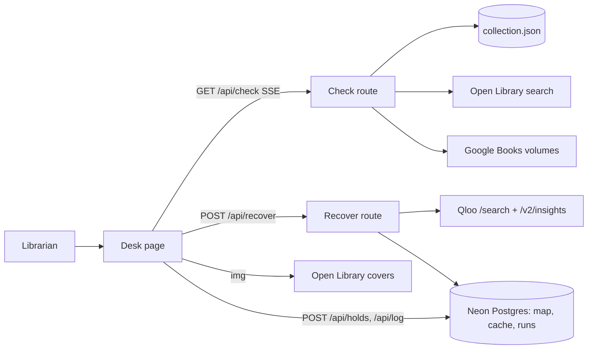

# Architecture — Ghost Shelf
Mode: hackathon. Last structural change: 2026-10-19 (ADR-0001 to ADR-0005).

## Overview
A reference-desk tool. A librarian types the title a patron asked for; the server checks three sources in sequence (the demo collection, Open Library, Google Books) and streams each result; the UI shows a plain card for the patron; if nothing was found and the patron named something they like (a film, a band, an author), the server asks Qloo for books the library holds that fit, with per-seed reasons; the librarian reserves them and logs the invented title. One Next.js app on Vercel, one Postgres (Neon), three public APIs, Qloo's hackathon API behind a server-side client with a labelled sample mode.

## Components
| Component | Responsibility | Tech | Why it exists (requirement) | When it fails |
|---|---|---|---|---|
| Web app (`src/app`) | the desk, the registry, reading lists, about | Next.js 16 App Router, React 19, Tailwind 4, motion | M1–M10, UI-SPEC | the browser shows the error state per region; the desk never blanks |
| Check route (`/api/check`, SSE) | runs the three sources in sequence, streams one event each, computes the verdict | route handler, `ReadableStream` | M1, M2, AC-2 to AC-4 | a source times out at 6 s → "did not answer"; the run continues |
| Demo collection (`data/collection.json` + table `collection_items`) | the catalog check and the holdings gate | a public-domain slice of Seattle Public Library's 2025 checkouts, loaded in memory on the server; the ISBN→Qloo entity map in Postgres | M1, M3, A-4 | JSON always loads; the map missing → recovery runs ungated and says so |
| Qloo client (`src/lib/qloo`) | resolve seeds (`/search`), recover books (`/v2/insights`) with the holdings gate in chunks, parse explainability, redact the request for the panel | `fetch` to `https://hackathon.api.qloo.com`, server only | M3, M7, M8, the sponsor rules | 401/429/5xx/empty → `SampleQloo` (deterministic subject overlap, labelled "sample mode") |
| Recover route (`/api/recover`) | seeds → three held books with reasons; rate-limited | route handler | M3, AC-5, AC-6, AC-10, AC-13 | returns the sample-mode result with its label, or 429 |
| Persistence (`src/db`) | runs, holds, invented titles, the Qloo cache, the collection map | Drizzle + `@neondatabase/serverless` (HTTP), lazy init; an in-memory adapter for tests | M4, M5 | DB unreachable → reserve and log report the failure; checks and recovery still run |
| Holds and log routes | write holds idempotently by run id; insert or increment the registry row | route handlers | M4, M5, AC-7, AC-8 | failure named in the button; nothing partial is hidden |
| Request panel data (`/api/request/last`) | the last run's redacted Qloo calls | stored on the run row | M7, AC-9 | "Run a check first" |
| Hosting | public URL, env vars, logs | Vercel (team lack-toes), Neon via the Marketplace | M9, the live-demo rule | smoke after every deploy; the URL stays up through judging |

## Data flow

## External services
| Service | Used for | Failure mode | Fallback | Limits / quota |
|---|---|---|---|---|
| Qloo hackathon API | seed resolution, book recovery, explainability | 401 (no key), 429, 5xx, no explainability | sample mode, labelled; reasons without shares | quotas "set high enough for typical hackathon projects"; private cache in Postgres; GET only; key never in the browser or the repo |
| Open Library search.json | existence check | timeout, 5xx | drawer "did not answer" | be gentle; one call per check |
| Open Library covers | cover images in the browser | 404 (none), 403 after 100 ISBN lookups per IP per 5 min | spine block with the title | 3 images per run from the judge's IP |
| Google Books volumes | existence check by title and author | 429 keyless | drawer "did not answer"; optional `GOOGLE_BOOKS_API_KEY` | keyless quota is low; one call per check |
| Seattle Public Library open data (SODA) | the demo collection, fetched once by a script | n/a at runtime | the committed JSON | public domain |
| Neon Postgres | holds, registry, cache, map | unreachable; autosuspend after idle | errors named; warm-up ping on deploy | hobby tier |

## Key decisions
- ADR-0001 One Next.js app on Vercel, no separate API service — the three routes and the UI share types and deploy together.
- ADR-0002 The demo collection is a committed public-domain JSON slice plus a Postgres table for the Qloo map — the catalog check must work with no DB; the map is Qloo-derived and stays out of the repository.
- ADR-0003 Qloo behind a `QlooClient` interface with `LiveQloo` and `SampleQloo` — the key is issued manually; the product must be complete and honest before it arrives.
- ADR-0004 Server-sent events for the checks — the drawers must answer one by one as each source replies, which one JSON response cannot show.
- ADR-0005 Neon via the Vercel Marketplace with Drizzle, lazy init, in-memory adapter for tests — one managed datastore, no build-time connection.

## Failure boundaries
Every external call has a 6 s timeout (covers: the browser's). A failed source degrades its drawer and the card's count; a failed Qloo call degrades to sample mode with a label; a failed DB degrades reserve and log only. Holds are idempotent per (run id, isbn). The rate limit (20/min/IP) is per server instance (Fluid Compute reuses instances; acceptable for a demo and stated in the README). No retries inside a request except one retry on a Qloo 5xx.

## Deployment
Vercel project `ghost-shelf` (team lack-toes); production on the default `.vercel.app` URL. Env: `QLOO_API_KEY` (server), `DATABASE_URL` (Neon, from the Marketplace), `GOOGLE_BOOKS_API_KEY` (optional), `NEXT_PUBLIC_DEMO=1` on the demo deployment (judge card on by default). Deploy with `vercel deploy --prod` after `pb.py verify`; roll back with `vercel rollback`. Migrations: `drizzle-kit push` from a local shell with `.env.local` sourced; the seed script loads the collection and the ten example registry rows.

## Observability
Structured console logs with a run id on every route; Vercel runtime logs; the run row stores timings per source and the Qloo latency; an error boundary per page region.

## Known tradeoffs
In-memory rate limiting; a 3,000-title demo collection instead of a live catalog; sample mode is a deterministic rule, not Qloo, and says so; covers depend on Open Library's IP limit.
