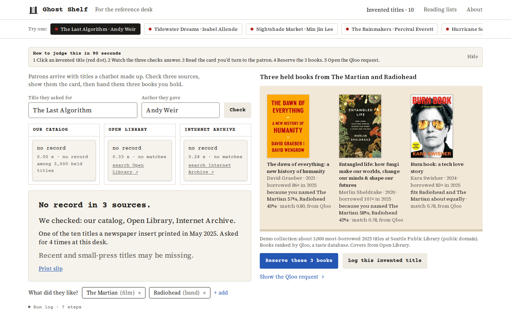

# Ghost Shelf

**A desk tool for book titles a chatbot made up.**



Live: **https://ghost-shelf.vercel.app** · Judge view: [`?judge=1`](https://ghost-shelf.vercel.app/?judge=1) · License: MIT

A patron asks for a book a chatbot recommended. Ghost Shelf checks the title against the catalog, Open Library and a third public source, shows the patron what it found, then uses Qloo, a taste database, to turn what they named (a film, a band, an author) into three books the library holds. The librarian reserves them and logs the invented title so the next desk recognises it.

## What it does

- **Three checks with receipts.** The demo collection (a real table), Open Library and the Internet Archive (Google Books when a key is set) are queried together and each drawer opens as its answer lands, with the result, the elapsed time and a link to repeat the search.
- **The patron card.** "No record in 3 sources", "Exists, and we hold it", "Exists; we don't hold it", or "No record in 2 sources" when a source did not answer. It never says a book does not exist, and it keeps the caveat that recent and small-press titles may be missing. It prints as a slip.
- **Recovery through Qloo.** What the patron liked (a film, a band, an author, a book, a show) becomes three books the library holds, each with the reason it was chosen and, when Qloo returns it, the share each seed contributed.
- **Reserve and log.** Holds go to a demo holds list (idempotent per run); the invented title joins a registry that ships with the ten titles printed in a newspaper insert in May 2025. The top-bar count ticks.
- **The Qloo request panel.** Every call as sent: parameters, the holdings-gate chunk count, a response excerpt, and "Copy as curl" with the key as a placeholder.
- **Reading lists.** The second desk: a patron's form becomes five to ten held books with reasons, approved into a draft reply that is shown and never sent.
- **Every state is reachable.** `?state=no-record`, `exists-held`, `source-failed`, `holds-placed`, `panel-open` and the rest (`src/components/desk/fixtures.ts`); `?record=1` for a recording; alt+shift+R resets, alt+shift+P replays.

## How to judge this in 90 seconds

1. Open the live URL. The first screen is a finished run of the first preset.
2. Click an invented title (red dot) and watch the three checks answer in sequence.
3. Read the card you would turn to the patron.
4. Press **Reserve these 3 books**, then **Log this invented title**; the count in the top bar ticks.
5. Open **Show the Qloo request** to see the calls as sent.

## How Qloo is used

Recovery is the step only Qloo can do here, and it runs on the server (`src/lib/qloo/live.ts`, `src/lib/recover.ts`):

1. **Search** resolves each thing the patron named to a Qloo entity: `GET /search` with `query` and `types` chosen from the seed's kind (`urn:entity:movie`, `urn:entity:artist`, `urn:entity:person`, `urn:entity:book`, `urn:entity:tv_show`). The patron's own words stay on screen; Qloo's canonical name is kept beside them.
2. **Insights** asks for books that fit all of them at once: `GET /v2/insights` with `filter.type=urn:entity:book`, `signal.interests.entities` = the resolved seeds, `filter.results.entities` = the Qloo entity ids of the demo collection (sent in chunks of 200, so the answer can only contain books the library holds), `filter.exclude.entities` for what the patron already has or rejected, `feature.explainability=true` and `take=50`.
3. **The holdings map** (ISBN to Qloo entity id for the collection) was built once with the key by `scripts/build-map.ts` (`npm run map:build`): 1,165 of the 3,000 held titles resolved to a Qloo book entity (exact edition or same title within two years), 849 of them fiction. It lives in the database and is sent as `filter.results.entities` in chunks of 200, so Qloo ranks only held books; titles without an entity cannot be recommended. The map is never committed: the repository holds no Qloo response data.
4. **Reasons.** When explainability comes back, each book's reason line names the seeds with their share ("because you named The Martian 61%, Radiohead 39%"); otherwise it names the seeds without shares. The affinity is shown as "match 0.74, from Qloo".
5. **Sample mode.** When `QLOO_API_KEY` is absent, or a Qloo call fails (401, a 429 that a single retry does not clear, a timeout), the checks and the card still run live and the shelf shows three held books picked by a deterministic non-taste rule, labelled "Sample mode" on screen and in the request panel. The hackathon key is issued by hand, so the product stays complete while it is pending.

The request panel shows the calls exactly as sent, with the key redacted at write time; the stored run (`GET /api/request/last`) never carries it either.

## What makes it Qloo-powered

- **Cross-category recovery.** A film and a band become three held novels. A catalog can match an author; it cannot take "The Martian" and "Radiohead" and return books, and that is the moment at the desk when the patron has nothing to go on but what they like.
- **Held books only.** `filter.results.entities` with the collection's entity ids means Qloo ranks within what the library can actually hand over, not the whole book universe.
- **Reasons the librarian can say out loud.** Explainability turns a ranking into "because you named…", which is what gets said across the desk.
- **No Qloo, no recovery.** Take the key away and the shelf says so. The checks and the card do not depend on Qloo; the step that gives the patron a book does.

## The agentic loop

The desk is a small agent with the librarian in the loop: it checks three sources concurrently and streams each answer (SSE), decides the branch from the results (held, not held, no record, unchecked), recovers through Qloo only when there is no record and the patron named something, and reserves and logs only when the librarian presses the button. The run log under the card lists each step with the second it landed.

## Configuration

| Variable | Purpose |
|---|---|
| `QLOO_API_KEY` | The Qloo hackathon key. The client only ever calls `https://hackathon.api.qloo.com`, sends the key in the `X-Api-Key` header, never in a URL, a log, a response or the client bundle. Absent: sample mode, labelled. |
| `DATABASE_URL` | Neon Postgres for runs, holds, the registry, the holdings map and a small cache. Absent: an in-memory store per server instance, labelled on the desk and the registry page; it resets on deploy. The live demo runs on Neon. |
| `GOOGLE_BOOKS_API_KEY` | Optional. With it, Google Books is the third check; without it, the Internet Archive (keyless) takes the third drawer, because Google Books rate-limits keyless hosts. |
| Rate limits | 20 a minute per IP on the write routes, 30 on checks, 120 on reads, 240 on covers; counted per server instance. |
| `NEXT_PUBLIC_DEMO` | `1` shows the judge card by default on the demo deployment (`?judge=0` hides it, `?judge=1` shows it anywhere). |

Run it:

```bash
npm install
npm run dev            # http://localhost:3000
npm test               # Node's test runner
npm run typecheck && npm run build
npm run db:push && npm run db:seed          # with DATABASE_URL: tables, then the ten example registry rows
npm run fetch:collection                    # rebuild data/collection.json from Seattle's open data (about 10 minutes)
node scripts/fetch-covers.mjs               # resolve Open Library cover ids for the collection (about 2 minutes)
node scripts/verify-states.mjs --serve all  # build first; screenshots every state at 1440, 390 and 320 into qa/
```

## Data and sources

- **The demo collection** (`data/collection.json`): about 3,000 of the most-borrowed book titles with ISBNs, January to September 2025, from Seattle Public Library's public-domain [Checkouts by Title](https://data.seattle.gov/Community/Checkouts-by-Title/tmmm-ytt6) dataset. Each row keeps title, author, publisher, year, subjects and the 2025 checkout count.
- **The ten invented titles** (`data/presets.json`): the summer reading insert of 18 May 2025 in the Chicago Sun-Times, as reported by [CBS News Chicago](https://www.cbsnews.com/chicago/news/summer-reading-ai-generated-titles-chicago-sun-times), with the real authors the insert attributed them to. Two real titles (one held, one not) sit beside them.
- **Covers** (`data/covers.json`): Open Library cover ids for the collection, resolved once; served through `/api/cover/<id>` with a long CDN cache. Never fetched by ISBN at request time (that lookup is rate-limited per IP).
- **Open Library** search, the **Internet Archive** advanced search, optionally **Google Books**, and the **Qloo Insights API** (hackathon edition).

No Qloo response data is stored in this repository: `data/` holds the collection, the presets and the cover ids only; the holdings map and any cached Qloo answers live in the database.

## What is live and what is simulated

| Part | Live or simulated |
|---|---|
| The three checks | Live, at check time, with links and timings |
| The patron card | Live, from the checks |
| Recovery | Live through Qloo (Search, Insights with the holdings filter, explainability); sample mode only when Qloo does not answer, labelled |
| Covers | Live from Open Library by cover id, through this site |
| Reserve | Simulated: a demo holds table, not a library system |
| The registry | This demo's own table, seeded with the ten documented example titles |
| Reading lists | Live recovery; the reply is a draft, never sent |
| The collection | Real public-domain data |

## Limits

Recent and small-press titles may be missing from the sources checked, so the card never says a book does not exist. The collection is a demo slice of one library's data. Holds and the registry are this demo's own. When Qloo does not answer, the shelf runs in sample mode for that run and says so.

## Timeline and tools

Planning (idea research, UI spec) came before the first commit on 19 October 2026; all code was written inside the hackathon window. Built for the Qloo Agentic Hackathon on Devpost.

AI coding tools: Claude Code (Anthropic's Claude) wrote and ran most of the code under the builder's direction, with the builder reviewing, testing and deciding what shipped. The demo video's narration is a synthetic voice (Kokoro), and the video says so where it matters: the hackathon key was pending when it was recorded.

## Layout

`src/app` pages and routes (`/`, `/invented`, `/lists`, `/about`, `/api/check`, `/api/recover`, `/api/holds`, `/api/log`, `/api/registry`, `/api/request/last`, `/api/lists`, `/api/cover/[id]`) · `src/lib` the check, the sources, the Qloo client (live and sample), recovery, normalisation · `src/db` the Drizzle schema and the memory and Postgres adapters · `src/components/desk` the desk, its fixtures and choreography · `tests` the Node test suite · `scripts` data, covers and the browser gate · `docs/memory` decision and failure records.
